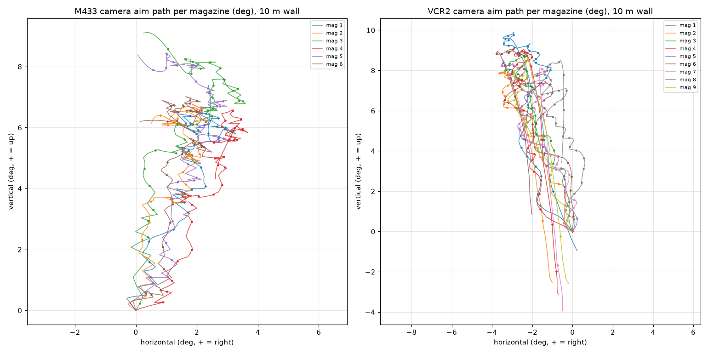
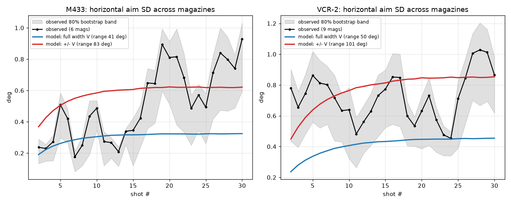
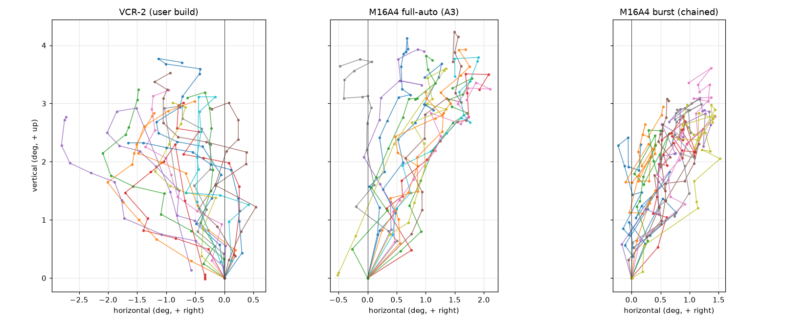
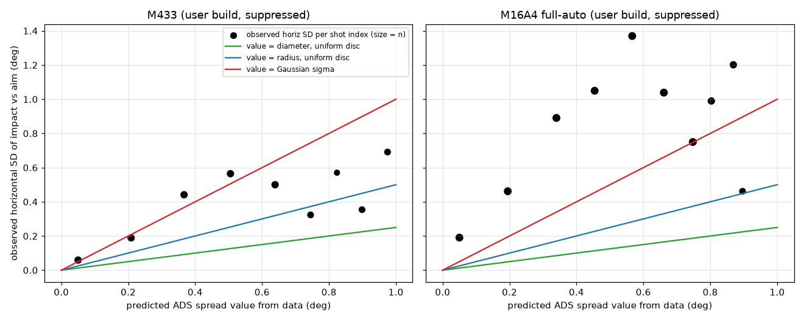
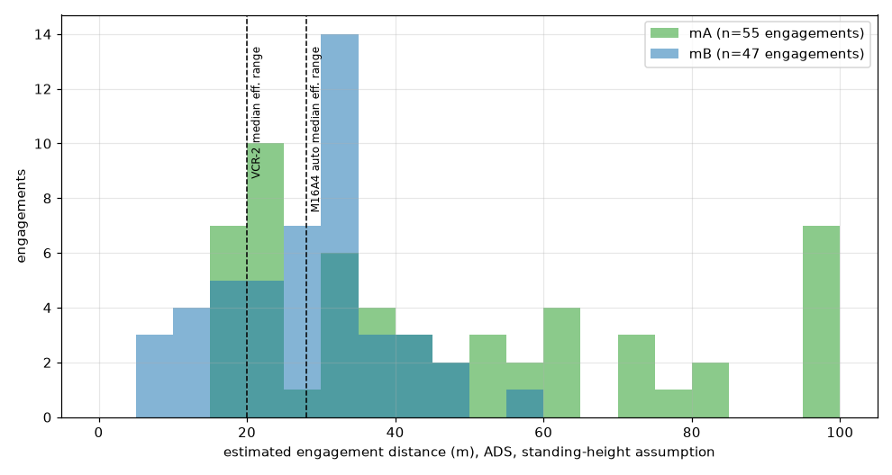
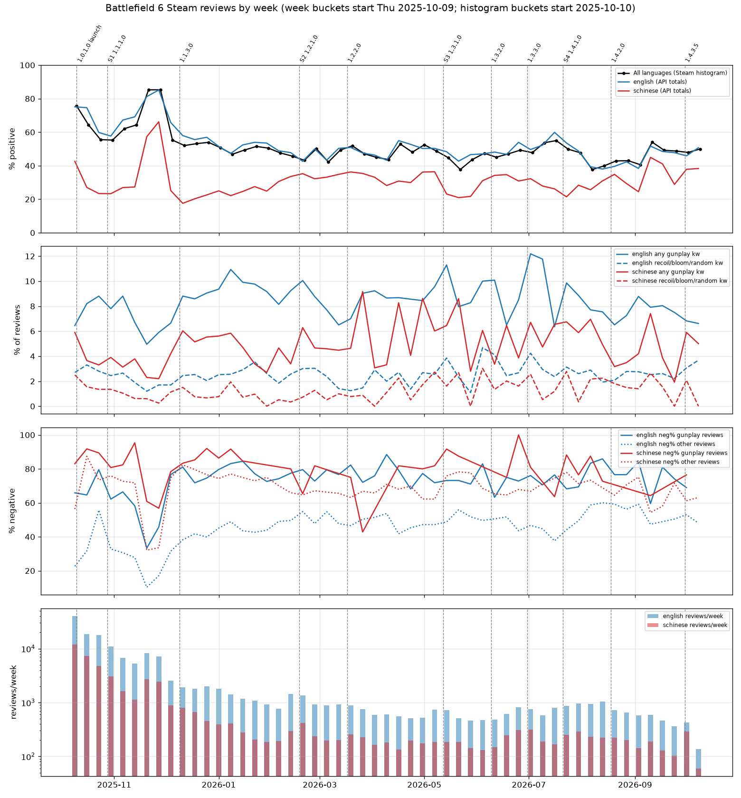
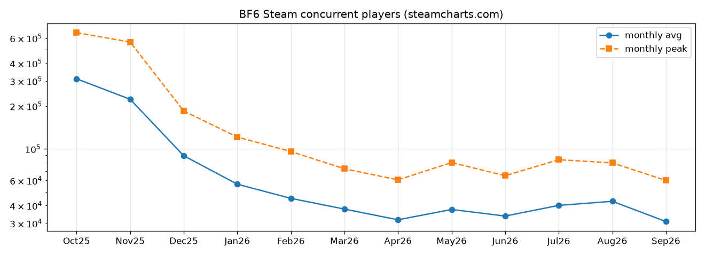

# 《战地风云 6》Gunplay 拆解案：被随机性吞噬的枪法

> **核心结论**：BFV 和 2042 一路收敛了枪械的随机性，《战地风云 6》却把 Gunplay 的随机性重新拉回了 BF4 时代，还在其上叠加了更大的单发上抬和随机的垂直后坐力。结果是枪械（尤其是高射速自动武器）的表现更随机，也更不可控。
>
> 本文依据四类证据：
>
> - 游戏文件取证；
> - 120 fps 实测录像（静止 / 移动 / 点射 / 实战）；
> - 版本史与玩家评测统计；
> - 与 BF4 / BFV / 2042 公开数据的逐项对比。
>
> **数据基准**：本机 Steam 安装版本（2026-10-10 读取，含 Season 4 与 1.3.3.0 之后的数值），已与 sym.gg 数据文件（1.4.2.0 / 2026-08-18）逐项比对。

---

## 0. 结论总览

| # | 结论 | 关键证据 | 章节 |
|---|---|---|---|
| 1 | **武器差异被压缩到“射速”一维**：同口径共享同一份子弹数据，伤害贴着击杀发数阈值设计，扩散增长也按口径统一 | 7 把 5.56 突击步枪引用同一个子弹资产 `PD_556x45mmNATO`；所有可得版本中伤害曲线从未变化 | §2 |
| 2 | **后坐力是“固定幅度 + 每发独立随机方向”，不存在可背的图案** | 文件中无任何逐发图案表；实测 VCR-2 不控枪，第 10 发方向从几乎垂直（−4°）到向左横跳（−51°）不等 | §3 |
| 3 | **随机方向的真实离散比文件的保守读法更大** | 弹匣间横向离散为“全宽”模型的 1～2 倍，VCR-2 接近“±V”（随机范围翻倍） | §3.4 |
| 4 | **扩散（bloom）至少按“半径”起作用，呈“首发极准、随后陡增”** | 三把枪、两种状态的弹着点实测：σx / 扩散值 = 0.55～0.76；首发 0.05°，5.56 每发 +0.36°，第 4 发起扩散锥超过 30 m 处躯干宽度 | §4 |
| 5 | **单次扫射的有效射程是一个宽分布，开枪前无法预知** | 最佳估计：VCR-2 中位 20 m（P10–P90 为 12～29 m）；M433 中位 22 m；去掉方向随机后 VCR-2 中位升到 31 m | §5 |
| 6 | **常见交战距离正好落在随机性主导的区间** | 六局实战（两局 AI、四局真人）的交战中位距离约 15～30 m；近距离地图“国王炮阵”有 41～59% 的交战超出 VCR-2 的中位有效射程；有效射程更远的全自动 M16A4 在帝国之州真人局中为 17～39% | §6 |
| 7 | **移动惩罚是 0/1 式**：一动就切换到移动扩散档，与速度无关 | 全局档位表中所有自动武器默认 0.32°（静止的 6.4 倍）；实测移动时离散为静止的 2～3 倍，与移动速度无正相关 | §7 |
| 8 | **S3 先加大后坐力随机，再把随机转移到扩散** | 1.3.1.0 把 35 把自动武器统一加重一档；1.3.3.0 下调方向随机，同时将 ADS 每发扩散增量 +33% | §8 |
| 9 | **四肢倍率结构性地奖励高射速**；近距离射速为王，中距离起随机度反超 | 烘焙伤害表 = 100 / (N − 0.16)，两次以上非胸部命中即 +1 发，+1 发的代价 = 60000 / RPM | §9 |
| 10 | **M16A4 的“稳定”是隐藏特权；“最精准、最可控”只属于三连发** | 自带随机度减免指数 +3，有效随机度 29.2°，且未吃 S3 的统一加重；实测三连发扩散约为全自动的一半，爬升形成 2～2.6° 平台 | §10 |
| 11 | **与前作相比**：随机性回到 BF4 水平，比 BFV / 2042 高约 2～4 倍，并新增竖直随机与更大的单发上抬 | 10 发水平随机累积：BF6 VCR-2 为 0.61～1.16°，BFV / 2042 同类为 0.18～0.50°；第 10 发扩散为 BFV / 2042 的 2.5～3 倍 | §11 |
| 12 | **玩家体验受到可测的负面影响，但 Gunplay 不是唯一原因** | S3 开局后 Steam 周好评率 52.5% → 37.7%，简中约 21～23%；后坐力 / 随机类抱怨占比显著上升（英文 z = 3.1，中文 z = 3.8），这类评测差评率 82～86% | §12 |

---

## 1. 证据来源与方法

### 1.1 游戏文件取证

1. **解包**：游戏资源为 Frostbite CAS/TOC 格式。`.toc` 被加密，但 `.cas` 数据块是**未加密的 Oodle 压缩块**。用游戏目录自带的 `oo2core_9_win64.dll` 逐块解压约 113 GB 的多人模式资源，得到约 89.8 万个 EBX 资产分区，并建立 38.9 万条“GUID → 资产路径”映射，用于解析资产间引用。
2. **字段定性**：EBX 字段名多为哈希，所以用 sym.gg 公开的带字段名 `bf6.json` 与本地 `GS_<武器>`（GunSway）资产逐项交叉对照。61 把武器中 59 把自动完全匹配，其余 2 把手工核对后一致。另有 exe 中残留的明文枚举与成员名作为佐证，如 `GunSwayDispersionAction_Moving`、`MovingZoomedMinAnglesIndex`。
3. **生效值的算法**：
   - 后坐力幅度 = `RecoilAmount × 幅度乘数^指数`；
   - 方向随机度 = `Variation × 随机度乘数^指数`；
   - 配件以“档”修改指数，点数编码在资产名后缀 `_Wxx` 中。

### 1.2 实测录像

全部为 2560×1600 录像，除第一组为 60 fps 外均为 120 fps。

| 组 | 内容 | 用途 |
|---|---|---|
| A | M433（6 个弹匣）/ VCR-2（9 个弹匣）裸枪，10 m 岩壁，不控枪 | 后坐力方向、幅度、回正、弹匣间离散 |
| B | M433 / M16A4（全自动，A3 机匣）常用配装，约 20 m 墙面 | 扩散尺度 |
| C | M16A4 全自动补录（13 串）、M16A4 三连发（9 串）、VCR-2 常用配装（16 串） | 射击模式对比、后坐力轨迹 |
| D | VCR-2 / M433 开镜左右平移射击 | 移动扩散 |
| E | 六局实战：污染、帝国之州（Portal AI 局）；哈根塔尔基地、国王炮阵、帝国之州 ×2（真人局，有 AI 补位；帝国之州第二局为全自动 M16A4 补录） | 交战距离 |
| F | 靶场 5 / 10 / 20 / 30 / 40 / 50 m 人形靶截图 | 距离标定 |

**处理流程**：

- **射击时刻**：由音轨检测枪声；各枪实测射速与数据完全一致，例如 VCR-2 为 66.7 ms/发（900 RPM），M16A4 为 77.8 ms/发（771 RPM）。
- **相机旋转**：对屏幕上方墙面逐帧做相位相关配准。
- **像素→角度**：以 HUD 指南针刻度标定，ADS 约 19 px/°（误差按 ±15% 计）。
- **弹着点**：配准后相邻帧差分，提取新出现的火花团；火花在竖直方向会向上溅射，因此**只用水平分量**。
- **实战距离**：用 YOLOv5s 检测准星附近的人形，逐张人工复核后，按靶场标定换算距离。

### 1.3 数值模型

用蒙特卡洛模拟单次扫射（每把枪 20,000 次）。

- **武器参数**：全部来自游戏文件。
- **行为假设（不来自文件）**：
  - 射手能抵消后坐力的**平均**方向和幅度，即已经背熟这把枪的平均手感；
  - 随机残差只靠引擎回正消除，按实测每发约消去 8～10%；
  - 后坐力方向按实测取“±V”口径；
  - 扩散按实测取“半径”口径；
  - 目标为 0.40 × 0.50 m 的躯干框。
- **有效射程**：单次扫射能在“理想击杀发数 + 1 发”之内完成击杀的最远距离，即允许一发打偏。

### 1.4 局限

- 无法取得发售至 S1 的后坐力数据，sym.gg 于 2026-01 才收录 BF6。
- 实测只有一名射手；实战只有六局，测距误差约 ±15%，因此给出上下界。
- 模型未包含头部 / 四肢命中、网络延迟与人类反应时间。
- Reddit 等站点无法直连，相关材料只作旁证。

---

## 2. 武器同质化：伤害与口径绑定

### 2.1 子弹资产按“口径 × 类别”命名，武器直接引用

`Common/Hardware/Weapons/_Bullets/` 下的投射物资产按 `PD_<口径>_<类别>` 命名，例如 `PD_556x45mmNATO`、`PD_556x45mmNATO_Carbine`、`PD_556x45mmNATO_MG`、`PD_762x39mm_Carbine`、`PD_9x19mm_PDW`。解析每把武器蓝图（`<武器>_WB`）的引用，得到：

| 子弹资产 | 引用它的武器 |
|---|---|
| `PD_556x45mmNATO` | **M433、VCR-2、M16A4**、B36A4、SOR-556 MK2、L85A3、EF88（全部 7 把 5.56 突击步枪） |
| `PD_556x45mmNATO_MG` | L110、DRS-IAR、M123K、KTS100 MK8 |
| `PD_556x45mmNATO_Carbine` | M4A1、GRT-BC、BROD 3 |
| `PD_762x39mm_Carbine` | **SG 553R**（唯一引用者） |
| `PD_9x19mm_PDW` | SGX、PW5A3、KV9、SL9、CZ3A1、PP-19 |

伤害相同不是巧合：这些武器从资产结构上就共享同一份数据。

### 2.2 伤害曲线贴着击杀发数阈值设计

| 组别 | 0 m 起 | 断点与衰减 |
|---|---|---|
| 5.56 AR / LMG | 25（4 发） | 21 m → 20（5 发）；75 m → 16.7（6 发） |
| 5.56 卡宾 | 25 | 9 m → 21.5；21 m → 17.7；36 m → 16.7；75 m → 14.3 |
| 7.62×39 AR / LMG | 33.4（3 发） | 9 m → 27.3；21 m → 21.5；36 m → 20；75 m → 16.7 |
| SG 553R | 33.4（3 发） | 9 m → 25；21 m → 20；36 m → 16.7；75 m → 14.3 |
| 9mm SMG | 25 | 9 m → 20；21 m → 16.7；36 m → 14.3；75 m → 12.5 |

33.4、25、20、16.7、14.3、12.5 分别对应恰好 3、4、5、6、7、8 发击杀。武器之间的伤害差异，被压缩成“在哪个距离掉一档发数”。

版本史显示，这些伤害曲线**在所有可得版本中从未变化**（§8）。

### 2.3 烘焙伤害表：对四肢倍率的“一发宽容”

子弹资产中，实际查表用的烘焙浮点值略高于设计关键帧：

| 设计值 | 烘焙值 | 规律 |
|---|---|---|
| 33.4（3 发） | 35.22 | 100 / 2.84 |
| 25（4 发） | 26.05 | 100 / 3.84 |
| 20（5 发） | 20.67 | 100 / 4.84 |
| 16.7（6 发） | 17.13 | 100 / 5.84 |

规律是 `烘焙值 = 100 / (击杀发数 − 0.16)`，即 `(N−1)·x + 0.84·x = 100`。也就是说，在 1.3.3.0 引入的 0.84 腹部 / 四肢倍率下，一次 N 发击杀中**只有一发**打在四肢时发数不变，**两发及以上**才 +1 发。

游戏内改装界面显示 M16A4 伤害为 **26**（不是 25），与烘焙值 26.05 一致，说明游戏实际使用的是烘焙表。

### 2.4 口径同时决定扩散增长

| 口径组 | ADS 每发扩散增量 |
|---|---|
| 5.56 AR / LMG | 0.360° |
| 5.56 卡宾 / 5.8 | 0.304° |
| 7.62×39 / 6.8 | 0.409° |
| 7.62×51 | 0.523° |
| 5.45 / 9mm | 0.280° |
| **SG 553R** | **0.360°**（5.56 档，而非 7.62×39 的 0.409°） |

SG 553R 是唯一一把“伤害按 7.62×39 卡宾、扩散增长按 5.56”的武器，高伤和好控两头都占了便宜。这与它在 1.1.3.0、1.2.1.0、1.3.1.0、1.3.3.0 中被反复点名削弱相吻合。

### 2.5 同弹种内：射速 = 强度

| 5.56 AR | RPM | 0–21 m TTK（4 发） | 21–75 m TTK（5 发） | 每多 1 发的代价 |
|---|---|---|---|---|
| VCR-2 | 900 | **200 ms** | **267 ms** | 67 ms |
| M433 | 831 | 217 | 289 | 72 |
| M16A4 | 771 | 233 | 311 | 78 |
| B36A4 | 720 | 250 | 333 | 83 |
| EF88 | 675 | 267 | 356 | 89 |
| L85A3 | 635 | 283 | 378 | 94 |
| SOR-556 MK2 | 568 | 317 | 422 | 106 |

同为 `PD_556x45mmNATO`，理想 TTK 只由射速决定。5.56 AR 与卡宾射速区间相同，但 AR 的伤害曲线在任何距离都不劣于卡宾。M433 同时拥有 831 RPM 和 AR 衰减，这正是它“全能步枪”地位的数据基础。

### 2.6 改装只能削减“幅度”，几乎碰不到“随机”

后坐力修正器（`_WeaponModifiers/Recoil/GRM_*`）的作用：

| 修正器 | 幅度档 | 随机度档 |
|---|---|---|
| 握把 `GRM_Recoil_BTM_P10…P50` | +1 … +5 | 0 |
| 制退器类枪口 | +1 | 0 |
| “转换型”枪口 `GRM_RecoilConversion_MZL_P10` | −1 | **+3** |
| 竞赛扳机 | +3 | 0 |

以 M433 为例，裸枪幅度 0.793。握把 5 档加枪口 1 档后为 0.565（−29%），再加竞赛扳机为 0.478（−40%）。而方向随机度**只有转换型枪口能改**（41.4° → 约 32.5°），代价是幅度 −1 档。

结论：改装能明显压低“枪跳得多高”，而这部分本来就能靠平均补偿学会。真正决定“这一梭子能不能打中”的方向随机度和扩散，改装几乎碰不到。

---

## 3. 随机后坐力

### 3.1 机制

- 每把枪有固定的幅度（`RecoilAmount`）、基准方向（`RecoilDirection`，相对竖直的偏角）和方向随机范围（`RecoilDirectionVariation`）。
- **幅度固定，方向每发独立随机**，属于极坐标式后坐力；没有首发后坐力倍率。
- 由于随机的是“方向”，**竖直分量也随之逐发波动**。这是 BF6 与 BF4 / BF1 / BFV / 2042 的根本区别：前作的竖直上抬都是固定值（§11）。

### 3.2 不存在“后坐力骨架”

社区中流传着“后坐力骨架”的说法，但逐项检查 `GS_<武器>` 中的所有数组，包括 60 项扩散状态表、200 项过渡表和修正器引用表，**不存在任何逐发后坐力骨架或多套预设骨架**。HIP 和 ADS 的后坐力参数各只有一组标量。

“有时稳、有时乱跳”的体感，是独立随机变量累积的自然结果：有的扫射前几发方向恰好互相抵消，有的恰好连续偏向一侧。实测 9 个 VCR-2 弹匣的轨迹也没有聚成几种固定形状，而是一个连续分布。

### 3.3 实测：方向与幅度与文件吻合，回正是线性弹簧



| | 实测平均每发踢动 | 数据文件 |
|---|---|---|
| M433 | 0.74°，偏右 19.7° | 0.79°，`RecoilDirection = −22`（偏右 22°） |
| VCR-2 | 0.74°，偏左 18.2° | 0.82°，`RecoilDirection = +18`（偏左 18°） |

- 爬升可用 `偏移 ← λ·偏移 + 踢动` 拟合，第 1～20 发误差在 0.3° 以内。M433 的 λ = 0.899/发（约 1.47/s），VCR-2 为 0.924/发（约 1.19/s）。不压枪时，准星在 15～20 发后稳定在起点上方 6～8°。
- 引擎回正会自动压住平均后坐力的一大半；但在 830～900 RPM 下，每发间隔只能消去 8～10% 的**随机**累积误差，随机偏差几乎原样叠加。

### 3.4 实测：随机离散至少等于“全宽”，VCR-2 接近“±V”

`RecoilDirectionVariation` 有两种读法：

- **全宽**：方向在基准 ± V/2 内随机；
- **±V**：方向在基准 ± V 内随机，总宽为 2V。

弹匣间“第 N 发准星横向位置”的标准差：



| | 第 5 / 10 / 20 发横向 SD（实测） | 全宽模型 | ±V 模型 |
|---|---|---|---|
| M433（6 匣） | 0.51 / 0.49 / 0.81° | 0.27 / 0.30 / 0.32° | 0.51 / 0.59 / 0.62° |
| VCR-2（9 匣） | 0.86 / 0.64 / 0.63° | 0.34 / 0.41 / 0.44° | 0.65 / 0.77 / 0.84° |

真实随机性在“全宽”的 1～2 倍之间，VCR-2 全程与 ±V 相符。

VCR-2 九个弹匣在第 10 发时的横向位置，折算到 30 m 处相对平均值的偏差为：−23、+3、+4、−12、**−57**、+22、+4、**+67**、−9 cm。躯干半宽约 20 cm，**有 1/3 的弹匣在第 10 发时就已偏出躯干**。

### 3.5 实测：同一把枪、同一个人、不控枪，第 10 发可能在任何方向



VCR-2 常用配装，16 串连射，不控枪。第 10 发时准星相对竖直方向的偏角：

- 最接近垂直的一串：向左 **4.3°**；
- 最偏的一串：向左 **50.8°**，此时已向左偏 2.8°，上抬却只有 2.3°；
- 平均向左约 21°，标准差 12.3°。平均值与数据中的 18° 基准方向吻合，离散与约 50° 的随机锥相符。
- 第 10 发的水平位置从 −0.22° 分布到 −2.80°，跨度超过 2.5°，在 20 m 处约 0.9 m，比躯干宽度的两倍还大。

---

## 4. 随机扩散

### 4.1 数据

- **起始扩散**：所有自动武器的 ADS 静止最小扩散为 **0.05°**，首发扩散倍率为 1.0；站、蹲、趴三种姿态的 ADS 数值**完全相同**，蹲下开火没有扩散收益。
- **增长与回落**：每发增量按口径统一（§2.4）；射击中按 `Offset + Coef·s^2.5` 的速率回落（5.56：Offset 2.7°/s，Coef 1.2）。
- **M433 连射时的扩散序列**：第 1 发 0.05° → 0.21 → 0.36 → 0.50 → 0.62 → 0.73 → 0.82 → 0.89 → 0.94 → 0.98 → 1.02 → 1.04°（第 12 发）。30 m 处躯干半宽对应约 0.38°，因此**从第 4 发起，扩散锥已大于躯干本身**。

### 4.2 实测：扩散值至少按“半径”起作用

对每一发，用数据模型算出“此刻的扩散值 s”，再与实测“弹着点相对瞄准点”的水平标准差 σx 对比：



| 扩散值的含义 | 预期 σx / s | 实测 |
|---|---|---|
| 均匀圆盘的直径 | 0.25 | 被排除 |
| 均匀圆盘的半径 | 0.50 | — |
| 高斯 σ | 1.00 | — |
| — | — | M433 静止 **0.73**（0.56～0.89）；VCR-2 静止 **0.63～0.75**；M433 / VCR-2 移动 0.64 / 0.55 |

- 三把枪、两种运动状态都落在“半径”与“高斯 σ”之间，水平分布尾部比高斯更重。
- 首发实测 0.024～0.05°，与数据中 0.05° 的起始扩散吻合，说明测量本身的噪声很小。
- 结论：文件中的扩散值**至少**是随机圆的半径。“扩散其实只有一半”的乐观读法不成立。

### 4.3 “首发极准、随后陡增”：点射是唯一的有效应对

M16A4 三连发与全自动的对比（同一默认枪管）：

| | 首发 | 第 4～12 发 | 第 13～25 发 |
|---|---|---|---|
| 全自动（A3 机匣） | 0.10° | **0.97°** | 1.02° |
| 三连发 | 0.07° | **0.33°** | 0.46° |
| VCR-2 常用配装（全自动） | 0.06° | 0.35° | — |

水平稳健标准差，按连射串做 bootstrap，结论只看量级。三连发的扩散约为全自动的 1/3～1/2。

模型比较显示，点射之间的空档若按“停火回落”（7.2/s）计算，比按“开火中回落”（2.7/s）更贴合数据。也就是说，**组间约 112 ms 的空档已被游戏当作停火**，扩散快速回落。

### 4.4 设计目标与实际效果的矛盾

- **开发者意图**（1.3.3.0 开发者博客）：“To reward proper shooting technique, we've slightly increased bullet deviation after the first shot, making controlled bursts or tap fire even more important…”
- **1.3.3.0 补丁说明**：扩散增长平均 +14%，高伤武器最高 +22%。
- **实际效果**：
  1. 引擎回正在连射中始终生效，本可让全自动“压得住”，扩散却抵消了压枪这项技能的回报；
  2. 点射的收益只来自“让扩散回落”，而回落速率按口径统一，玩家能优化的空间很小；
  3. 扩散不可见，直到 1.4.2.0 才加入可选的扩散指示器。在此之前，玩家看不到当前扩散有多大。

---

## 5. 双重随机的后果：开枪前不知道有效射程

最佳估计口径：±V 随机方向 + 半径型扩散；裸枪、站立 ADS、躯干命中；单次扫射在“理想发数 + 1”内击杀。

| 武器 | 有效射程 P10 / 中位 / P90（m） | 去掉方向随机（V = 0）后的中位 |
|---|---|---|
| VCR-2 | 12 / **20** / 29 | 31 |
| M433 | 15 / **22** / 35 | 33 |
| M4A1 | 15 / 23 / 36 | 34 |
| KV9 | 15 / 22 / 34 | 32 |
| SG 553R | 16 / 25 / 35 | 35 |
| M16A4（全自动） | 20 / **28** / 43 | 37 |
| B36A4 | 20 / 30 / 47 | 40 |
| SOR-556 MK2 | 40 / 60 / 74 | 69 |

1. **同一把枪的单次有效射程跨度很宽。** VCR-2 的 P10 到 P90 跨 12～29 m：有时 12 m 就开始漏枪，有时 29 m 还能打满。
2. **方向随机是首要随机源。** 去掉它，VCR-2 的中位有效射程从 20 m 升到 31 m。扩散与方向随机是叠加的两套系统。
3. **稳定性随射速反向排列**：越快的枪越早进入随机区间。
4. 由于取了偏悲观的 ±V 口径，M433 等离散较接近“全宽”的武器，实际有效射程可能略好于表中数值；但整体结论不变。

---

## 6. 实战交战距离：随机区间就是常用区间

### 6.1 方法

- **距离换算**：靶场 5～50 m 人形靶的“画面高度 × 距离”为常数，腰射约 1170 px·m，开镜放大 ×1.45。按 ADS 19 px/° 反推出的靶高约 1.56 m，两条标定链吻合。按士兵身高 1.75 m 取：红点 ≈ 1900 px·m；M16A4 机械瞄具实测放大约 ×1.34，取 ≈ 1760 px·m。
- **识别**：每串射击前后取帧，用 YOLOv5s 检测准星 60 px 内的人形，人工剔除载具、标记、尸体与己方武器。
- **区间**：人形框高宽比中位数只有约 1.83（站立约 2.6～3.0），目标多在奔跑、蹲伏或半掩。因此“按身高”换算的距离为**上界**，“按身宽 0.65 m”换算的距离为**下界**。
- **选择偏差**：漏测的多是暗处、烟雾、贴脸和腰射交战，大多是近距离，所以真实分布比下表更偏近。

### 6.2 结果



（图中每个点是一串测得距离的射击：蓝点为下界，紫点为上界，竖线为中位数；红色底带为该枪单次扫射有效射程的 P10～P90，红线为其中位数（§5）。图中 n 为测得距离的射击串数，表中交战数为合并相隔 0.6 s 内射击串后的结果。）

| 对局 | 武器 | 交战（测得 / 总数） | 中位距离（下界～上界） | 超出该枪**中位**有效射程 | 超出有效射程 P10 |
|---|---|---|---|---|---|
| 污染（AI 局） | VCR-2 | 55 / 99 | **26～40 m** | **62～89%** | 91～100% |
| 帝国之州（AI 局） | M16A4 全自动 | 47 / 196 | 18～29 m | 10～55% | 47～76% |
| 哈根塔尔基地（真人） | VCR-2 | 22 / 65 | 11～18 m | 9～36% | 36～95% |
| 国王炮阵（真人） | VCR-2 | 54 / 134 | **17～23 m** | **41～59%** | 67～91% |
| 帝国之州（真人·一） | M16A4 全自动 | 6 / 52 | 8～14 m | —（样本不足） | — |
| 帝国之州（真人·二） | M16A4 全自动 | 17 / 97 | **17～29 m** | 24～53% | 29～65% |
| 帝国之州真人两局合计 | M16A4 全自动 | 23 / 149 | 15～22 m | 17～39% | 22～57% |

帝国之州真人第二局为补录的全自动 M16A4（机械瞄具）实战，13 分钟，音频实测射击间隔 77.2 ms（771 RPM）。这局有大量室内、楼梯和窗口交战，测得比例只有 17/97，漏测的以贴脸和腰射交战为主。

### 6.3 解读

- 六局合计，交战中位距离约 **15～30 m**，正好覆盖主流高射速 5.56 武器有效射程的 P10～中位数（VCR-2 为 12～20 m，M433 为 15～22 m）。
- **M16A4 全自动**的有效射程更远（中位 28 m），因此在同类距离上受随机性的影响明显小于 VCR-2：帝国之州真人两局中，只有 17～39% 的交战超出它的中位有效射程，而污染 / 国王炮阵的 VCR-2 分别为 62～89% 和 41～59%。不过，帝国之州真人第二局中仍有约三成到六成的交战超过 M16A4 的 P10 有效射程（20 m），即进入“运气差就打不出理论 TTK”的区间。这与 §10 的结论一致：M16A4 的稳定性特权让它在中距离更可靠，但全自动模式下随机性并没有消失。
- 即使在近距离地图“国王炮阵”，约一半的交战里，一梭子能否打出理论 TTK 也接近抛硬币。
- “哈根塔尔基地”的大部分交战在 VCR-2 的中位有效射程以内，但仍有相当一部分超过 12 m，落在“运气差就打不出理论 TTK”的区间。
- **随机性并不只在远距离起作用**：在常见交战距离上，主流突击步枪单次扫射的有效性，已有相当一部分由后坐力和扩散的随机结果决定。
- **限制**：六局、单一射手、两局为 AI 对局，M16A4 真人样本合计只有 23 次交战；测距误差约 ±15%，上下界相差约 1.5 倍。本节是量级证据，不是精确分布。

---

## 7. 0/1 式移动惩罚

### 7.1 文件证据

1. **引擎状态枚举**（exe 明文）：`GunSwayDispersionAction_{Default, Moving, Jumping, Sprinting}`。扩散由离散状态选择，状态集合中没有“速度”维度。
2. **武器属性**：`WeaponAttribute_ADSStationaryDispersion` 与 `WeaponAttribute_ADSMoveDispersion`，即“静止”与“移动”两个数。
3. **全局档位表** `Common/Hardware/Common/Arrays/DispersionADS/ZDA_Moving_Weapons`：

   | 档位 | 1 | 2 | 3 | **4（所有自动武器默认）** | 5 | 6 | 7 |
   |---|---|---|---|---|---|---|---|
   | ADS 移动最小扩散 | 0.05° | 0.13° | 0.22° | **0.32°** | 0.43° | 0.55° | 0.68° |

   武器只存一个档位索引（`MovingZoomedMinAnglesIndex`），配件只能把它整档 ±1。
4. **1.3.1.0 补丁说明**：“Added a slight delay before entering ADS locomotion from a standstill”。从静止进入“移动”状态需要越过一个门槛，这是开关式设计的旁证。

### 7.2 实测

| | 首发水平 SD | 第 4～12 发水平 SD |
|---|---|---|
| M433 静止 → 移动 | 0.05° → **0.15°**（×3） | 0.20° → **0.48°**（×2.4） |
| VCR-2 静止 → 移动 | 0.06° → 0.38°（噪声大） | 0.35° → **0.70°**（×2） |

- 换用移动档参数（最小扩散 0.32°）重新拟合，扩散刻度（σx/s = 0.55～0.64）与静止时一致。游戏只是整体切换到移动档，没有别的隐藏惩罚。
- 按移动档预测，首发水平 SD 约 0.19°，M433 实测 0.15°，吻合。
- 用近处地面相对远处墙面的视差衡量移动速度：逐串扩散与移动速度**无正相关**（Spearman ρ = −0.26，p = 0.29，n = 18），与“一动就切换、与速度无关”相符。这一检验较弱，只能算不矛盾。

### 7.3 结论

- 慢挪一步与全速平移吃同一档扩散；所有自动武器默认同一档，武器之间在这一项上没有任何个性。
- “静止 / 移动”两档结构是系列通用设计（§11）。BF6 移动档的绝对值（0.32°）与 BFV / 2042 同档；但因为静止首发极准，**移动档相对静止档的倍数（×6.4）是系列最大**，“停下来”和“动一下”之间的落差最陡。

---

## 8. 版本史：S3 的随机性去向

**数据来源**：GitHub 上的独立存档，包括 sym `bf6.json` 1.2.2.0 导出、SheetOnMyFace 表格的 sym 归档页，以及 sym 补丁对比页内嵌的 1.3.1.0 → 1.3.3.0 差值。各来源重合字段零冲突。

**有效方向随机度（°）**

| 武器 | 1.2.2.0（S2） | 1.3.1.0（S3 开局，05-12） | 1.3.3.0 起至今（06-30） |
|---|---|---|---|
| VCR-2 | 49.1 | **64.9** | 50.3 |
| M433 | 45.1 | **50.9** | 41.4 |
| SG 553R | 33.8 | **43.3** | 35.8 |
| KV9 | 53.8 | **57.6** | 50.0 |
| CZ3A1 | 52.6 | **59.1** | 50.8 |
| M4A1 | 31.9 | **37.9** | 30.7 |
| B36A4 | 37.4 | 37.4 | 28.0 |
| M16A4 | — | 35.8 | 29.2 |

**有效后坐力幅度与扩散增长**

| 武器 | 有效幅度（S2 → S3 开局 → 当前） | ADS 每发扩散增量 |
|---|---|---|
| M433 | 0.718 → 0.780 → 0.793（+10%） | 0.27 → 0.27 → **0.36（+33%）** |
| VCR-2 | 0.771 → 0.814 → 0.821（+6%） | 0.27 → 0.27 → 0.36 |
| SG 553R | 0.755 → 0.822 → 0.827（+10%） | 0.27 → 0.27 → 0.36 |
| KV9 | 0.475 → 0.542 → 0.538（+13%） | 0.21 → 0.21 → 0.28 |

1. **1.3.1.0**：35 把既有自动武器的基础后坐力指数全部由 −2 调到 −3，即统一加重一档；另有 22 把上调幅度、20 把上调随机度，以高射速武器为主。VCR-2 的随机度达到 64.9°，为全游戏突击步枪最高。
2. **1.3.3.0**：37 把自动武器的方向随机度全部下调；但同时 ADS 每发扩散增量统一 +33%，开火中扩散回落的 Offset 由 1.84 提到 2.7，弹头阻力 +40%。**随机性被从“后坐力方向”转移到了“扩散”，总量并没有回到 S2 水平。**
3. **1.3.3.0 → 1.4.2.0**：上述字段没有变化。
4. **伤害**：所有可得版本中从未改变。

结论：S3 开局到 1.3.3.0 之间（05-12 至 06-30）是后坐力随机最严重的时期；此后随机转移到扩散，一直延续至今。

---

## 9. 四肢倍率与射速：高射速在近距离被结构性奖励

### 9.1 1.3.3.0 的部位倍率（EA 补丁说明）

| 武器类 | 头 | 胸 | 腹 / 四肢 |
|---|---|---|---|
| 自动武器 | 1.34/1.5/1.75 → **1.4/1.57/1.8** | 1.0 | 1.0 → **0.84** |
| DMR | 1.34/1.5/1.75 | 1.0 | 1.0 → 0.91 |
| 狙击 | 1.75 | — | 0.8 → 0.67 |

改装界面显示的爆头倍率 ×1.40 与之一致。

### 9.2 为什么奖励高射速

1. 自动武器共享同一套部位倍率，同口径共享同一条伤害曲线（§2）；
2. 由烘焙表（§2.3），两次及以上非胸部命中即 +1 发；
3. +1 发的时间代价 = 60000 / RPM：VCR-2 为 67 ms，SOR-556 为 106 ms；
4. 在双重随机（§3～§5）下，打偏、打到四肢是常态而非例外，每一次“+1 发”对高射速武器的惩罚都更小。

所以，以“放慢平均 TTK、奖励精准”为目标的 1.3.3.0，在“同口径同伤害”的框架下，**结构性地放大了射速的价值**。

### 9.3 但射速优势有距离上限

射速越高，随机度普遍越大（附录 B）。§5 的有效射程表显示，VCR-2 的中位有效射程只有 20 m，而 M16A4（全自动）为 28 m、B36A4 为 30 m。因此：

- **20 m 以内**，射速为王；
- **20～30 m 起**，低随机度的武器开始反超。

---

## 10. M16A4：隐藏的稳定性特权

### 10.1 文件层面的特权

`GS_M16A3`（M16A4 的内部代号）的后坐力块与其他 5.56 AR 有两处结构差异：

| 字段 | M16A4 | 其他 5.56 AR |
|---|---|---|
| 幅度指数（基础） | **−2** | −3 |
| 方向随机度指数（基础） | **+3** | 0 |
| 有效随机度 | 37.5° × 0.9197³ = **29.2°** | M433 41.4° / VCR-2 50.3° |

- M16A4 出厂就自带相当于一个“转换型枪口”的随机度减免（+3 档），而且不占枪口位、不扣幅度。全部自动武器中，有非零基础随机度指数的只有 M16A4 和 VSSM。
- S3 开局补丁 1.3.1.0 把所有既有自动武器的基础幅度指数由 −2 调到 −3；同一补丁上线的 M16A4 却以 −2 出厂，一直保持至今。
- 界面显示的随机度 37.5° 是基础值，实际生效的是 29.2°，玩家从界面上看不到这层差异。

### 10.2 射击模式决定了一切

M16A4 默认不是全自动，全自动由人体工学槽的 A3 机匣（`WPM_ERG_FullAutoReplace_W30`，25 点）开启。实测：

| | 第 4～12 发扩散 | 第 10 发上抬 / 水平 | 第 13 发上抬 | 第 10 发水平离散 |
|---|---|---|---|---|
| 全自动（A3 机匣） | 0.97° | 3.06° / +1.10° | 3.67°，持续爬升 | 0.54° |
| **三连发** | **0.33°** | **1.99°** / +0.73° | **2.04°**（第 22 发也只有 2.65°） | **0.39°** |

- **射速核对**：全自动实测 771 RPM；三连发的组内间隔同为 77 ms，连续点射时组间最短约 112 ms，等效约 674 RPM。
- **后坐力**：同一组三发内的上抬与全自动完全相同（约 0.5°/发）。差别来自组间空档：每个空档准星回落约 0.35°（约 3°/s，为持续射击时的两倍以上），总上抬因此稳定在 2.0～2.6° 的平台上。
- **扩散**：同样来自组间空档被当作停火（§4.3）。
- **TTK 代价**（26 伤害）：

  | 命中所需发数 | 全自动 | 三连发 | 代价 |
  |---|---|---|---|
  | 4 | 233 ms | 266 ms | +14% |
  | 5 | 311 ms | 343 ms | +10% |

### 10.3 结论

- **三连发 M16A4 是当前版本最精准、最可控的 5.56 突击步枪之一**：扩散与 VCR-2 同档，后坐力随机度更低，爬升形成平台。它用约 10～14% 的理论 TTK 换来了大幅下降的随机性；在中距离，脱靶减少后的实际 TTK 往往更好。
- **全自动 M16A4 牺牲了精度，换来更好的理论 TTK**：实测扩散约为 M433 的 1.6 倍（149 发样本，σx/s = 1.20 对 0.73）。两套配装的枪管相同，所以原因更可能在 A3 机匣或全自动模式本身（界面精准 28 → 24）。两套配装的握把与枪托也不同，确切来源未定（§14）。帝国之州真人实战中，全自动 M16A4 的交战中位距离约 15～22 m，大多落在它的中位有效射程（28 m）以内（§6）。在这类距离上，全自动的 TTK 优势能够兑现。
- M16A4 的地位本身说明：**玩家追求的是可预测性，而这种可预测性被做成了少数武器、少数射击模式的隐藏特权**，界面上只显示一个抽象的“精准”数值。

---

## 11. 跨系列对比：从收敛回到 BF4

### 11.1 口径

- **数据**：sym.gg 旧站公开的各代数据文件（`bf4.json`、`bfv_P.json`、`bf2042.json`）与机制说明页。均取裸枪（或不影响后坐力与 ADS 扩散的配件组合）、站立开镜。BF1 没有现代突击步枪，未纳入。
- **前作后坐力**：竖直上抬为**固定值**；水平在 [−左, +右] 之间均匀随机。sym 原文：“vertical recoil is a fixed (non-randomized) value… horizontal… uniform distribution”。
- **前作扩散**：
  - BF4：扩散为“随机圆的半径”，按住扳机时不回落，逐发线性累积；
  - BFV / 2042：按帧回落，公式与 BF6 同族；
  - BFV 的 ADS 扩散按半径均匀分布（向中心偏置），并且连射时**扩散会转化为可见的准星移动**。
- **BF6 的区间**：左值为“全宽”口径，右值为“±V”口径（§3.4）。

### 11.2 对比表

“10 发水平随机累积”= 每发水平随机 SD × √10，表示一梭子横向随机游走的量级。

| 游戏 | 武器 | RPM | 每发上抬 | 每发水平随机 SD | 10 发水平随机累积 | ADS 静止 / 移动最小扩散 | 第 10 发扩散 |
|---|---|---|---|---|---|---|---|
| BF4 | M416 | 750 | 0.32°（固定） | 0.12° | 0.36° | 0.20° / 1.00° | 1.08° |
| BF4 | ACE 23 | 770 | 0.36°（固定） | 0.13° | 0.40° | 0.20° / 1.00° | 1.10° |
| BF4 | AEK-971 | 900 | 0.42°（固定） | 0.20° | 0.64° | 0.20° / 1.00° | 1.25° |
| BF4 | FAMAS | 1000 | 0.40°（固定） | 0.29° | 0.91° | 0.25° / 0.80° | 1.42° |
| BFV | StG 44 | 599 | 0.67°（固定） | 0.12° | 0.38° | 0.10° / 0.30° | 0.34° |
| BFV | Sturmgewehr 1-5 | 670 | 0.75°（固定） | 0.16° | 0.50° | 0.10° / 0.30° | 0.44° |
| BFV | Ribeyrolles 1918 | 539 | 0.53°（固定） | 0.06° | 0.18° | 0.10° / 0.30° | 0.34° |
| 2042 | AK-24 | 649 | 0.41°（固定，前 3 发 ×1.25～1.4） | 0.09° | 0.28° | 0.11° / 0.26° | 0.32° |
| **BF6** | **VCR-2** | 900 | **0.68～0.75°（随机）** | **0.19～0.37°** | **0.61～1.16°** | 0.05° / 0.32° | **1.07°** |
| BF6 | M433 | 831 | 0.67～0.72°（随机） | 0.15～0.29° | 0.48～0.92° | 0.05° / 0.32° | 0.99° |
| BF6 | M16A4 | 771 | 0.65～0.67°（随机） | 0.10～0.20° | 0.32～0.62° | 0.05° / 0.32° | 0.90° |
| BF6 | B36A4 | 720 | 0.68～0.70°（随机） | 0.10～0.19° | 0.31～0.61° | 0.05° / 0.32° | 0.82° |
| BF6 | SOR-556 MK2 | 568 | 0.61°（随机） | 0.04～0.08° | 0.12～0.25° | 0.05° / 0.32° | 0.50° |

### 11.3 结论

1. **BFV 和 2042 已经把随机性收敛下来。** 两代同类步枪的 10 发水平随机累积为 0.18～0.50°，第 10 发扩散为 0.32～0.44°，BFV 还让扩散以准星移动的形式可见。
2. **BF6 主流高射速步枪的随机性回到了 BF4 时代。** VCR-2 / M433 的 10 发水平随机累积为 0.48～1.16°，与 BF4 的 AEK-971 / FAMAS（0.64～0.91°）同档，在“±V”口径下更高；对比 BFV / 2042 高出约 **2～4 倍**。第 10 发扩散 0.8～1.07°，接近 BF4（1.08～1.42°），是 BFV / 2042 的 **2.5～3 倍**。
3. **BF6 在 BF4 的基础上又叠加了两层不可控因素。**
   - **更大的单发上抬**：0.61～0.75°，约为 BF4 同类的两倍。
   - **随机的垂直后坐力**：前作的竖直上抬都是固定值，可以靠肌肉记忆抵消；BF6 的极坐标方向随机，使上抬本身逐发波动（SD 0.03～0.15°）。“能练出来的部分”比任何一代前作都少。
4. **扩散形态更极端**：首发最小扩散 0.05° 为系列最低，每发增量 0.36° 却是 BF4 的 3～4 倍，首发几乎没有扩散，之后每发都迅速放大。BF6 也没有 BFV 那种可见的扩散反馈。
5. **不是所有 BF6 武器都更随机**：M16A4、B36A4、SOR-556 在“全宽”口径下的水平随机不高于 BF4 同类。但它们射速较低，或依赖隐藏的随机度特权（§10）。高射速主流武器才是随机性最重的一档。

**本节结论**：比起从 BFV 和 2042 开始逐步减少的随机性，BF6 把 Gunplay 的随机性重新拉回了 BF4 时代，还加上了更大的单发上抬和随机的垂直后坐力，使 Gunplay 更随机，也更不可控。

**局限**：

- 各代的 TTK、血量、交战距离与配件系统不同，同样的随机量对体验的影响不完全可比；
- BF4 扩散在圆内的分布形状未公开；
- 2042 数据文件只包含 27 把武器，缺少 M5A3 等主力步枪；
- BF6 的“全宽 / ±V”口径仍未完全确定。

---

## 12. 体验证据：Steam 评测与在线人数

**数据**：Steam 评测直方图（全语言，53 周）；逐周抓取的英文评测 55,478 条、简中评测 26,431 条；SteamCharts 月度和日度在线人数。



### 12.1 好评率

| 时间点 | 周好评率（全语言） |
|---|---|
| 发售周 | 75.7% |
| 1.1.3.0 之后到春季 | 约 45～52% |
| **S3 开局（05-12）后连续四周** | 52.5% → 48.8% → 44.8% → **37.7%**；简中从 36% 跌到约 **21～23%**，持续三周 |
| 1.3.3.0（06-30）后 | 回升至 47～54%；简中未回升 |
| 8 月初 | 47.7% → 37.7%，主因是模式删减，与枪械无关 |

### 12.2 枪械手感相关评测

- **占比上升**：S3 期间（05-12 至 07-20），后坐力 / 随机类关键词的评测占比显著高于 12 月至 5 月的基线。英文 3.08% 对 2.39%（z = 3.1），中文 1.94% 对 0.91%（z = 3.8）；“后坐力 / 后座”一词从 0.53% 升到 1.39%。
- **极度负面**：提到后坐力 / 随机的评测差评率为 82～86%，同期全体评测的差评率为 43～54%。
- **规模有限**：峰值也只占全部评测的 1～3%，S4 之后回落。补丁改变的是“抱怨的人数”，而不是“抱怨者的愤怒程度”（组内差评率基本不变）。

代表性评测（英文，按“有用”票数排序）：

- 2026-06-04：“The damn bullet spread, called ‘Bloom’ … they've decided … to implement absolute randomness. Even if you know a weapon's pattern, you're going to miss anyway…”
- 2026-07-01，338 票：“…keeping a recoil system which feels so bad that when it was discovered everyone thought it was a bug…”
- 2026-07-04：“Glorified hidden object game where skill does not matter. High ROF and no recoil is the only thing that matters.”
- 2026-07-25（社区讨论）：“Everything seems dictated by bloom and random recoil… Combined with the limb damage reduction, gunfights have become frustrating dice rolls.”

### 12.3 在线人数



月均在线从 2025-10 的约 31.1 万，降到 12 月的 9.0 万、2026-04 的 3.2 万。S3（5 月 3.8 万）和 S4（7 月 4.0 万）各有约 +18% 的赛季反弹，9 月回落到 3.1 万。日度数据从 2026 年 7 月中才开始，无法单独观察 S3 和 1.3.3.0 的周级影响。

### 12.4 结论边界

- **可以确认**：后坐力随机最严重的 S3 前半段，好评率跌到发售以来的最低区间，简中区尤甚；枪械随机性相关抱怨显著增多，且几乎一边倒地差评。
- **不能确认**：Gunplay 是好评率下跌或玩家流失的主因。同期还有赛季内容、外挂与网络问题、8 月的模式删减等混杂因素，而相关评测只占 1～3%。

---

## 13. 综合：枪法是如何被随机性吞噬的

```
同口径同伤害 + 伤害贴着击杀发数阈值
    └─> 武器差异被压缩为：射速 / 后坐力幅度 / 方向随机度
          ├─ 射速：线性决定 TTK，四肢倍率进一步放大其价值
          ├─ 幅度：可被改装削减 30～40%，也能被“平均补偿”学会
          └─ 方向随机 + 扩散：改装几乎碰不到、无法学习、不可见
                └─> 单次交火的有效射程呈宽分布（VCR-2：12～29 m）
                      └─> 这一区间正是常见交战距离（15～30 m）
                            └─> 玩家无法把输掉的交火归因于自己：练习 ≠ 进步，选枪 ≈ 选射速
0/1 移动惩罚（全武器统一，比例为系列最大）+ ADS 姿态无收益
    └─> 走位与站位对枪法的贡献被压缩，“技术”收束到“静止 + 点射”这一个解
```

对体验伤害最大的不是“随机”本身，而是**随机的不可读性**：

- 后坐力没有图案可背，连竖直上抬都在逐发波动，一梭子的好坏在开火前已由随机数决定；
- 扩散不可见，1.4.2.0 之前没有任何反馈；
- 稳定性被做成少数武器（M16A4）与少数射击模式（三连发）的隐藏特权，界面上只显示抽象的“精准 / 控制”数值。

### 13.1 结论的适用边界

- **开发者有明确的设计目标**：EA 将近距离 TTK 基准定在 200～300 ms，并表示“some variation is necessary to keep weapons balanced and to avoid having one weapon that becomes the default choice for everyone”。随机度确实是压制“高 DPS 在远距离也能打”的主要平衡杠杆。
- **1.3.3.0 曾往可预测方向修正后坐力**，但同时把随机转移到了扩散（§8）。所以当前版本的问题不能用“已经修了”来概括。
- **随机性可以缩小玩家水平差距**，这对大规模战场的大众玩家未必全无收益。我的判断是：它有收益，但代价过高。
- **“系列最差”不成立**：BF4 的高射速步枪在随机后坐力与扩散上与 BF6 同档。BF6 的问题在于逆转了 BFV / 2042 的收敛方向，并叠加了前作没有的竖直随机与更大的单发上抬（§11）。

---

## 14. 未决问题

1. **方向随机的确切口径**：实测介于“全宽”与“±V”之间，VCR-2 接近 ±V，M433 前 15 发更接近全宽。用更高帧率孤立单发踢动可以直接画出方向分布。
2. **全自动 M16A4 扩散偏大的确切来源**：A3 机匣、全自动模式本身（M16A4 独有的 `GRM_AutoIdentifier_P00`），还是握把 / 枪托差异？可用“全自动、不装 A3、其余与三连发配装完全相同”的对照录像确认；“冰冻枪管”能否把全自动扩散拉回三连发水平，也可一并测量。
3. **未定用途的数据**：子弹资产中的第二组烘焙伤害表（断点后移约 10 m），以及竞赛扳机的 1.728 倍乘数，用途尚不明确。
4. **发售至 S1 的后坐力数据**：目前缺失，无法确认 M433 在 S1 的数值。

---

## 附录 A：关键资产路径

| 内容 | 资产 |
|---|---|
| 子弹 / 伤害 | `Common/Hardware/Weapons/_Bullets/PD_*` |
| 武器蓝图（引用子弹） | `Common/Hardware/Weapons/<类别>/<代号>/<代号>_WB` |
| 后坐力 + 扩散（GunSway） | `Common/Hardware/Weapons/<类别>/<代号>/GS_<代号>` |
| ADS 移动扩散档位表 | `Common/Hardware/Common/Arrays/DispersionADS/ZDA_Moving_Weapons` |
| 腰射扩散档位表 | `Common/Hardware/Common/Arrays/DispersionHip/HDA_Weapons` |
| 后坐力修正器 | `Common/Hardware/Weapons/_WeaponModifiers/Recoil/GRM_*` |
| ADS 移动扩散修正器 | `Common/Hardware/Weapons/_WeaponModifiers/ADSMoveDispersion/GDM_Array_*` |
| 配件（含点数后缀） | `Common/Hardware/Weapons/_WeaponModifiers/{_Barrel,_Ergo,_Ammo,...}/WPM_*_Wxx` |

内部代号对照：`HK433` = M433，`VHS2` = VCR-2，`M16A3` = M16A4，`SIG553R` = SG 553R，`Vector` = KV9，`ScorpionEVO3` = CZ3A1，`MPX` = SGX，`G36` = B36A4，`SCARL` = SOR-556 MK2，`MSBSGrotB` = GRT-BC，`Bren3` = BROD 3，`APC10` = SCW-10。

## 附录 B：自动武器后坐力参数（本地文件，生效值）

| 武器 | 类别 | 口径 | RPM | 基准方向 | 有效随机度 | 裸枪有效幅度 | ADS 每发扩散 |
|---|---|---|---|---|---|---|---|
| VCR-2 | AR | 5.56 | 900 | +18° | 50.3° | 0.821 | 0.360 |
| M433 | AR | 5.56 | 831 | −22° | 41.4° | 0.793 | 0.360 |
| M16A4 | AR | 5.56 | 771 | −21° | **29.2°** | 0.730（全自动约 0.775） | 0.360 |
| B36A4 | AR | 5.56 | 720 | −15° | 28.0° | 0.726 | 0.360 |
| EF88 | AR | 5.56 | 675 | +11° | 26.1° | 0.724 | 0.360 |
| L85A3 | AR | 5.56 | 635 | +12° | 22.8° | 0.674 | 0.360 |
| SOR-556 MK2 | AR | 5.56 | 568 | −9° | 12.7° | 0.623 | 0.360 |
| KORD 6P67 | AR | 5.45 | 900 | +18° | 28.9° | 0.541 | 0.280 |
| NVO-228E | AR | 7.62×39 | 655 | −12° | 28.9° | 0.733 | 0.409 |
| TR7 | AR | 7.62×51 | 720 | +20° | 40.8° | 1.160 | 0.523 |
| AK4D | AR | 7.62×51 | 514 | −18° | 20.0° | 0.852 | 0.523 |
| M4A1 | 卡宾 | 5.56 | 900 | −18° | 30.7° | 0.848 | 0.304 |
| GRT-BC | 卡宾 | 5.56 | 831 | +16° | 26.1° | 0.807 | 0.304 |
| BROD 3 | 卡宾 | 5.56 | 831 | −16° | 24.3° | 0.835 | 0.304 |
| SG 553R | 卡宾 | 7.62×39 | 720 | −20° | 35.8° | 0.827 | **0.360** |
| KV9 | SMG | 9mm | 1080 | +22° | 50.0° | 0.538 | 0.280 |
| CZ3A1 | SMG | 9mm | 982 | −15° | 50.8° | 0.685 | 0.280 |
| SGX | SMG | 9mm | 831 | −18° | 31.7° | 0.601 | 0.280 |
| SCW-10 | SMG | 10mm | 800 | −18° | 33.5° | 0.712 | 0.360 |
| M123K | LMG | 5.56 | 831 | −10° | 47.7° | 0.611 | 0.360 |

基准方向的正值为偏左，负值为偏右（已由实测确认）。

## 附录 C：参考来源

- **EA 官方补丁说明**（`https://www.ea.com/en/games/battlefield/battlefield-6/news/` 下）：`battlefield-6-update-notes-1-0-1-0`、`battlefield-6-game-update-1-1-3-0`、`…-1-2-1-0`、`…-1-3-1-0`、`…-1-3-2-0`、`…-1-3-3-0`、`…-1-4-2-0`
- **EA 开发者博客**（2026-06-25）：`…/news/bf-combat-gunplay`
- **sym.gg**：
  - BF6：`https://sym.gg/legacy/pages/bf6/data/bf6.json`、`https://sym.gg/games/bf6/weapon-mechanics`、`https://sym.gg/games/bf6/patch-notes`
  - 前作数据：`https://sym.gg/legacy/pages/{bf4,bf2042}/data/*.json`、`https://sym.gg/legacy/pages/bfv/data/bfv_P.json`
  - 前作机制页：`https://sym.gg/legacy/pages/{bf4,bfv}/*_dataWeapon.html`、`https://sym.gg/legacy/pages/bf2042/bf2042_dataWeapon.html`
- **版本史存档**：GitHub `Copernicus10/BF6_weapon`（sym 1.2.2.0 导出）、`N1GHTKN1GHT69/bf6-weapons-lab`（SheetOnMyFace 归档）、`Whillyum/BF6-effective-TTK-sim`（sym 1.3.1.0）
- **Steam**：评测 API（app 2807960）、社区讨论区、SteamCharts

## 附录 D：复现

脚本与中间数据位于 `C:\Users\q1625\AppData\Local\Temp\opencode\bf6\`（临时目录，如需长期保留请自行备份）：

- **文件取证**：`cas.py` / `extract.py`（CAS 解块与 EBX 导出）、`index.py` / `guidmap.py`（资产索引与 GUID 映射）、`ebx.py` / `dump.py`（EBX 解析）、`table.py`（与 sym.gg 逐项比对）
- **模型**：`sim.py` / `sim_v2.py`（蒙特卡洛有效射程）
- **实测录像**（`video/`）：
  - `audio.py`（枪声检测）、`reg.py`（墙面配准）、`calib2.py`（指南针标定）、`kicks2.py` / `fit_decay.py` / `plot_paths.py` / `plot_sd.py`（踢动、回正与弹匣间离散）；
  - `feat3.py` / `impacts3.py` / `impacts5.py` / `spread_fit*.py` / `abs_spread.py` / `paths2.py`（弹着点与扩散拟合、后坐力轨迹）；
  - `mvcheck.py`（移动视差与移动扩散）；
  - `mshots.py` / `det.py` / `mdet.py` / `audit.py` / `mzoom.py` / `mdist.py` / `plot_engage2.py`（实战交战距离与图）
- **版本史**（`history/`）：`weapon_history.csv`（逐版本、逐字段注明来源）
- **体验**（`experience/`）：`weekly_reviews.csv`、`quotes.jsonl`、`players_monthly_steamcharts.csv`
- **跨系列**（`xseries/`）：`bf4.json` / `bfv.json` / `bf2042.json`、`xcompare.py` / `xcompare.json`

文中图片位于文档旁的 `BF6_Gunplay_拆解案_assets/` 目录。
